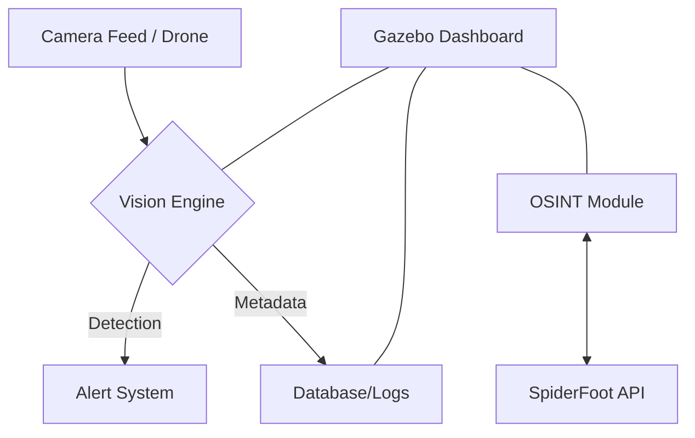

# 🌌 Gazebo AI: Integrated OSINT & Vision Intelligence Dashboard

[](https://opensource.org/licenses/MIT)
[](https://www.python.org/downloads/)
[](https://www.php.net/)

**Gazebo AI** is a professional-grade, hybrid physical-digital intelligence platform. It combines real-time computer vision (YOLOv8) with advanced Open Source Intelligence (OSINT) gathering tools to provide a unified surveillance and analysis dashboard.

Originally designed for drone search-and-rescue and security scenarios, Gazebo offers a seamless bridge between hardware sensor data and digital footprint analysis.

---

## 🚀 Key Features

### 👁️ Real-Time Vision Engine
- **Multi-Stage Detection**: Specialized YOLOv8 models for human and weapon detection.
- **Drone Optimized**: Designed to handle high-altitude and mobile camera feeds.
- **Alert System**: Immediate visual and auditory alerts with automatic logging and screenshot capture.

### 🌐 Advanced OSINT Integration
- **Palantir (SpiderFoot) Integration**: Directly embedded OSINT module for deep-dive investigations.
- **Automated Scanning**: Link physical detections to digital entities (IPs, Domains, Emails).
- **Network Mapping**: Visualize connections between targets in real-time.

### 📊 Professional Dashboard
- **PHP/JavaScript Backend**: Responsive, high-performance web interface.
- **Modular Design**: Easy to integrate new sensors or intelligence modules.
- **Dark Mode UI**: Optimized for tactical environments and long-duration monitoring.

---

## 🏗️ Architecture



---

## 🛠️ Tech Stack

- **Frontend**: PHP 8.x, Vanilla JS, Custom CSS (Glassmorphism)
- **Vision**: Python 3.x, Ultralytics YOLOv8, OpenCV
- **OSINT**: SpiderFoot (CherryPy), OSINT Framework
- **Deployment**: Windows / Linux (Cross-platform support)

---

## 📦 Installation

### Prerequisites
- Python 3.8+
- PHP 8.0+
- Web server (Apache/Nginx or built-in PHP server)

### Setup
1. **Clone the repository**:
   ```bash
   git clone https://github.com/EmirhanYAZICI/Gazebo.git
   cd Gazebo
   ```

2. **Install Python dependencies**:
   ```bash
   pip install -r requirements.txt
   ```

3. **Initialize the Web Dashboard**:
   - Point your web server to the `web/` directory or run:
   ```bash
   cd web
   php -S localhost:8000
   ```

4. **Start the Vision Engine**:
   ```bash
   python src/main.py
   ```

---

## 📖 Usage Guide

- **Camera Feed**: Access the live stream via the dashboard's "Vision" tab.
- **OSINT Search**: Navigate to the "Palantir" tab to initiate target scanning.
- **Logs**: Review historical detections in the `logs/` directory.

---

## 🤝 Contributing

Contributions are welcome! Please feel free to submit a Pull Request.

## 📄 License

This project is licensed under the MIT License - see the [LICENSE](LICENSE) file for details.

---

<p align="center">
  <i>Developed by <b>Emirhan Yazıcı</b></i>
</p>
