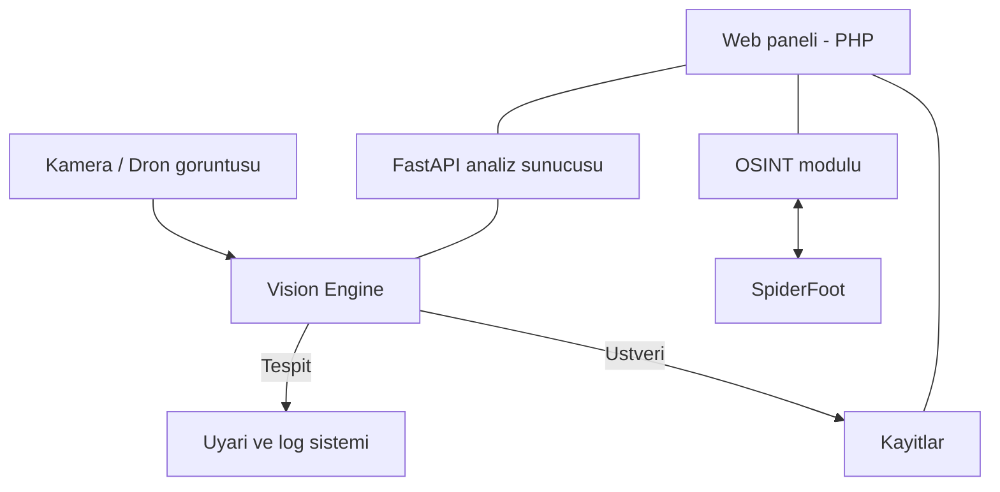

# Gazebo AI — Görüntü İşleme ve OSINT Kontrol Paneli

[](https://opensource.org/licenses/MIT)
[](https://www.python.org/downloads/)
[](https://www.php.net/)

Gazebo, kamera ve dron görüntüsü üzerinde gerçek zamanlı nesne tespiti yapan, fotoğraf üzerinden uçak yüzey hasarı analizi çıkaran ve SpiderFoot ile OSINT taraması yürüten üç modülü tek bir web panelinde toplar.

Arama-kurtarma ve güvenlik senaryoları düşünülerek tasarlandı: fiziksel ortamdan gelen tespit ile dijital ayak izi analizini aynı ekranda görmek.

---

## Modüller

### 1. Canlı İzleme — İki Aşamalı Tespit

Kameradan gelen görüntü gerçek zamanlı analiz edilir. Tespit tek aşamada değil, iki aşamada yapılır:

1. **İnsan tespiti** — COCO ile önceden eğitilmiş YOLOv8 modeli, düşük güven eşiğiyle (`0.30`) çalışır. Amaç uzak ve küçük hedefleri kaçırmamak.
2. **Nesne tespiti** — Yalnızca birinci aşamada bulunan insan bölgesi kırpılıp fine-tuned modele verilir, yüksek güven eşiğiyle (`0.60`). Amaç yanlış alarmı bastırmak.

Tüm kareyi ikinci modele vermek yerine yalnızca ilgili bölgeyi göndermek, hem yanlış pozitifi düşürür hem de işlem yükünü azaltır. İki eşiğin ayrı tutulması tasarımın özüdür ve `src/config.py` üzerinden değiştirilebilir.

Tespit anında sesli uyarı verilir, ekran görüntüsü alınır ve zaman damgalı log kaydı yazılır.

| Kutu rengi | Anlamı |
|---|---|
| Yeşil | Tespit edilen kişi |
| Kırmızı | Riskli olarak işaretlenen kişi |
| Mavi | Diğer nesne veya hayvan |

### 2. Fotoğraf Analizi

Yüklenen bir fotoğraf iki modda işlenebilir:

- **Güvenlik modu:** Fotoğraftaki kişileri ve nesneleri tespit eder, güven oranlarıyla listeler.
- **Ön uçuş modu:** Uçak dış yüzey fotoğrafında çizik, korozyon, perçin gevşemesi ve çatlak arar; bir hasar skoru üretip tahmini bakım süresini saat cinsinden hesaplar.

### 3. OSINT Taraması (SpiderFoot)

Panele gömülü SpiderFoot motoruyla IP, alan adı veya e-posta üzerinden açık kaynak istihbarat taraması başlatılır. Fiziksel tespitler dijital varlıklarla ilişkilendirilebilir. Tarama, hedefin derinliğine göre 5–15 dakika sürer ve geçmiş taramalar panelden incelenebilir.

---

## Mimari



Üç servis birlikte çalışır:

| Servis | Görev | Teknoloji |
|---|---|---|
| Analiz sunucusu | Fotoğraf analizi ve model çağrıları | Python, FastAPI |
| OSINT motoru | Veri toplama | SpiderFoot (CherryPy) |
| Web paneli | Arayüz | PHP 8, Vanilla JS, Three.js |

Kaynak düzeni:

```
src/
  vision_engine.py   Goruntu akisi ve tespit dongusu
  detector.py        Iki asamali tespit mantigi
  camera_stream.py   Kamera yonetimi
  alert_system.py    Uyari, ekran goruntusu, log
  api_server.py      FastAPI uc noktalari
  config.py          Tum ayarlar tek dosyada
web/                 PHP panel ve varliklar
spiderfoot/          Gomulu SpiderFoot (MIT)
```

---

## Kurulum

### Gereksinimler

- Python 3.8+
- PHP 8.0+
- Webcam veya video dosyası

### Adımlar

1. Depoyu klonlayın:

```bash
git clone https://github.com/EmirhanYAZICI/Gazebo.git
cd Gazebo
```

2. Python bağımlılıklarını kurun:

```bash
pip install -r requirements.txt
```

3. Model dosyalarını indirin. Model ağırlıkları (`*.pt`) depoya dahil değildir:
   - **İnsan modeli:** `yolov8n.pt` — [Ultralytics](https://github.com/ultralytics/ultralytics) üzerinden, proje kök dizinine.
   - **Nesne modeli:** `models/weights/best.pt` — fine-tuned model, HuggingFace veya Roboflow üzerinden.

4. Sistemi başlatın.

**Windows:** `baslat_web.bat` dosyasını çalıştırın. Üç servis arka planda açılır ve tarayıcıda `http://localhost:8000` adresi gelir.

**Elle başlatma:**

```bash
python src/api_server.py
```

```bash
cd web && php -S localhost:8000
```

```bash
python src/main.py
```

---

## Ayarlar

Tüm yapılandırma `src/config.py` dosyasındadır. En çok değiştirilenler:

| Ayar | Ne işe yarar |
|---|---|
| `CAMERA_INDEX` | Birden fazla kamera varsa seçim (0'dan başlar) |
| `CAMERA_RESOLUTION` | Performans için düşürülebilir |
| `YOLO_PERSON_CONFIDENCE` | İnsan tespiti eşiği; düşürmek hassasiyeti artırır |
| `YOLO_WEAPON_CONFIDENCE` | Nesne tespiti eşiği; yükseltmek yanlış alarmı azaltır |
| `DETECTION_MODE` | `two_stage` veya `single` |
| `ALERT_SOUND` | Sesli uyarıyı açar veya kapatır |

---

## Bilinen sınırlar

- Model ağırlıkları depoda yoktur, elle indirilmesi gerekir.
- Nesne tespiti hazır fine-tuned bir model kullanır; bu modelin başarımı kendi veri kümesiyle ölçülmemiştir.
- Sistem yerel ağda çalışacak şekilde kurgulanmıştır, kimlik doğrulama katmanı yoktur. Dışarı açık bir sunucuda çalıştırmayın.
- OSINT taramasının kapsamı SpiderFoot modüllerine girilen API anahtarlarına bağlıdır; anahtarsız kullanımda sonuçlar sınırlıdır.

---

## Sorun giderme

| Belirti | Çözüm |
|---|---|
| Panelde "No Signal" yazıyor | Kamerayı başka bir uygulama (Zoom, Skype) kullanıyor olabilir |
| Analiz çok yavaş | `src/api_server.py` terminalde çalışıyor ve hatasız olmalı |
| SpiderFoot açılmıyor | İlk açılışta veritabanı kurulumu 10–20 saniye sürer |

---

## Kullanılan açık kaynak projeler

- [Ultralytics YOLOv8](https://github.com/ultralytics/ultralytics) — nesne tespit motoru
- [SpiderFoot](https://github.com/smicallef/spiderfoot) — OSINT motoru, MIT lisanslı, `spiderfoot/` altında gömülü
- [FastAPI](https://github.com/tiangolo/fastapi) — analiz sunucusu
- [Three.js](https://github.com/mrdoob/three.js) — panelin 3D açılış ekranı

---

## Lisans

MIT — ayrıntı için [LICENSE](LICENSE) dosyasına bakın. Gömülü SpiderFoot kendi MIT lisansıyla gelir, `spiderfoot/LICENSE` dosyasında durur.

---

## Geliştiriciler

Emirhan Yazıcı · Oğuzhan Yazıcı
